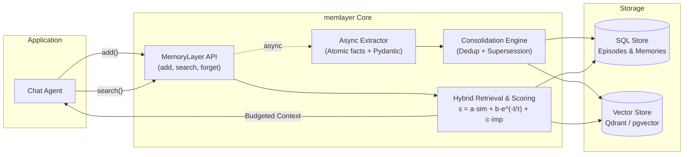

# Agent Memory Layer (`memlayer`)

[](https://github.com/Yash-lab01/Agent-Memory-Layer/actions)
[](https://www.python.org/downloads/)
[](https://github.com/astral-sh/ruff)
[](http://mypy-lang.org/)
[](https://opensource.org/licenses/MIT)

> **Durable, long-term memory for conversational agents — benchmarked on LongMemEval & LoCoMo.**

`memlayer` is a modular, transparent Python library and demo application that gives LLM chat agents persistent memory across sessions. It extracts atomic facts from conversation turns, maintains temporal provenance, resolves contradictions non-destructively through supersession, and retrieves relevant context using hybrid scoring.

Rather than claiming algorithmic novelty over existing systems (Mem0, Letta, Zep), `memlayer` focuses on **architectural rigor, measurable evaluation, and reproducible ablations**.

---

## Architecture Overview



---

## Key Features

- **Asynchronous Write Path:** Atomic fact extraction runs in the background after the chat response is returned to avoid latency penalties.
- **Non-Destructive Supersession:** Contradictory updates (e.g., "moved to Bangalore" vs. "lives in Pune") mark previous facts as `superseded` rather than hard-deleting them, preserving historical auditability.
- **Hybrid Retrieval & Calibrated Scoring:** Combines dense vector similarity with BM25 keyword matching, weighted by exponential time decay and fact importance.
- **Turn Gating Router:** Automatically skips memory lookups for non-informative turns ("thanks", "hello").
- **Strict Multi-User Isolation:** Every episode, memory item, and query is scoped by `user_id`.
- **Reproducible Evaluation Harness:** Benchmarked on subsets of **LongMemEval** and **LoCoMo** against full-context and naive RAG baselines.

---

## Quickstart (5 Commands)

```bash
# 1. Clone the repository
git clone https://github.com/Yash-lab01/Agent-Memory-Layer.git
cd Agent-Memory-Layer

# 2. Set up virtual environment
uv venv && source .venv/bin/activate  # Or on Windows: .venv\Scripts\activate

# 3. Install package with dev dependencies
uv pip install -e ".[dev]"

# 4. Copy environment configuration
cp .env.example .env

# 5. Run test suite
pytest
```

---

## Python API Example

```python
from memlayer import MemoryLayer

# Initialize memory layer (defaults to local SQLite + in-memory vector store)
mem = MemoryLayer()

# 1. Ingest a conversation turn
messages = [
    {
        "role": "user",
        "content": "I recently moved from Pune to Bangalore to work on conversational AI.",
    },
    {"role": "assistant", "content": "Congratulations on the move to Bangalore!"},
]
mem.add(user_id="user_123", messages=messages)

# 2. Query relevant memories for a subsequent turn
context = mem.search(
    user_id="user_123", query="Where do I live and what do I work on?", token_budget=300
)
print(context)
# Output:
# [Memories]
# - User lives in Bangalore (Event: 2026-10-12) [supersedes: lives in Pune]
# - User works on conversational AI (Event: 2026-10-12)

# 3. Explicit forget (GDPR / Privacy)
mem.forget(user_id="user_123", memory_id="...")
```

---

## Benchmark Results (LongMemEval / LoCoMo)

*Results will be published from reproducible runs recorded in `eval/results/`.*

| System | LongMemEval Acc (%) | Tokens / Query | Latency p50 (ms) | Cost / 1k Queries ($) |
|---|---|---|---|---|
| **Full-Context Baseline** | *TBD* | *TBD* | *TBD* | *TBD* |
| **Naive RAG Baseline** | *TBD* | *TBD* | *TBD* | *TBD* |
| **`memlayer` (Hybrid + Decay)** | *TBD* | *TBD* | *TBD* | *TBD* |

---

## Privacy & Data Ownership

- **Local-First Default:** Operates fully offline using SQLite and local vector storage without mandatory cloud services.
- **Per-User Isolation:** Complete data separation by `user_id` enforced across all storage and query boundaries.
- **Right to be Forgotten:** Dedicated `.forget(user_id, memory_id)` method provides hard deletion of specified records.
- **PII & Sensitivity Protection:** Designed to support pre-extraction PII masking before facts are committed to storage.

---

## License

This project is licensed under the [MIT License](LICENSE).
