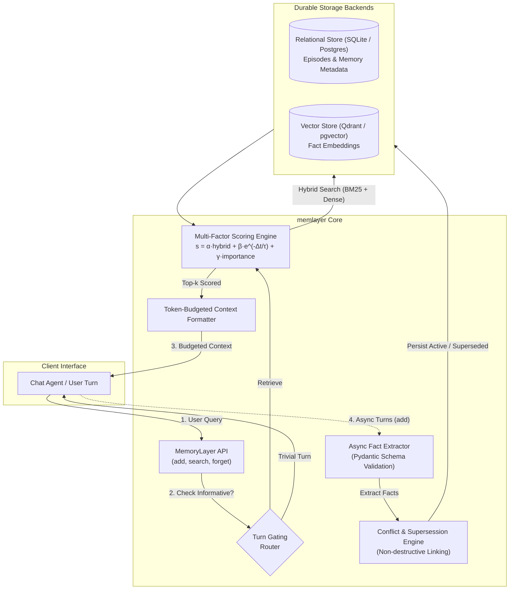

# Architecture & System Design

The **Agent Memory Layer (`memlayer`)** is designed around clear operational boundaries: strict asynchronous write path execution to prevent latency penalties on interactive turns, and hybrid, recency-calibrated retrieval with turn gating on read paths.

---

## High-Level Architecture

---

## 1. Write Path: Ingestion & Fact Extraction

1. **Immediate Episodic Logging:** Incoming conversation turns are immediately committed to relational storage (`episodes` table) with role, timestamp, session ID, and user ID. This ensures complete auditability and provenance.
2. **Asynchronous Fact Extraction:** Ingestion tasks run asynchronously in background execution (`add(..., background=True)`), shielding end-users from 200–800ms extraction latencies.
3. **Pydantic Validation & Retries:** Extracted atomic facts conform to strict Pydantic v2 schemas (`ExtractedFact`, `ExtractionResult`). Malformed responses trigger structured format repair.
4. **Conflict Supersession:** If an extracted fact contradicts an existing active fact for the same entity (e.g. residence or language preference), the old memory record is updated:
   - `status = MemoryStatus.SUPERSEDED`
   - `superseded_by = new_memory_id`
   - The old record is **never hard-deleted**, preserving historical truth.

---

## 2. Read Path: Hybrid Retrieval & Scoring

1. **Turn Gating Router:** Queries are evaluated by `RetrievalRouter`. Trivial, non-informational turns ("thanks!", "hello", "good morning") skip memory retrieval, returning 0 prompt tokens and incurring 0ms vector lookup overhead.
2. **Hybrid Retrieval:** Dense cosine similarity from Qdrant/pgvector is combined with sparse BM25 lexical keyword matching over memory text:
   $$score_{hybrid} = 0.5 \cdot sim_{vector} + 0.5 \cdot score_{bm25}$$
3. **Multi-Factor Scoring:** Candidate memories are scored by balancing semantic relevance, exponential recency decay, and intrinsic importance:
   $$score = \alpha \cdot score_{hybrid} + \beta \cdot e^{-\Delta t / \tau} + \gamma \cdot importance$$
   Where:
   - $\alpha = 0.6$: Semantic/lexical relevance weight
   - $\beta = 0.25$: Temporal recency decay weight ($\tau = 30$ days)
   - $\gamma = 0.15$: Fact importance weight
4. **Token-Budgeted Injection:** Scored memories are packed into formatted markdown prompt context until `token_budget` is reached, ensuring prompt limits are never exceeded.

---

## 3. Background Consolidation Worker

Durable long-term memory requires background maintenance to remain compact and clean:
- **Deduplication Engine:** Detects near-paraphrase memories using vector similarity thresholds ($> 0.92$) and merges redundant records.
- **Memory Decay Engine:** Gradually decays memory relevance over time while reinforcing frequently accessed memories via access counts (`access_count`).
- **Worker Scheduler:** Runs periodic maintenance sweeps using `APScheduler` without blocking user threads.
