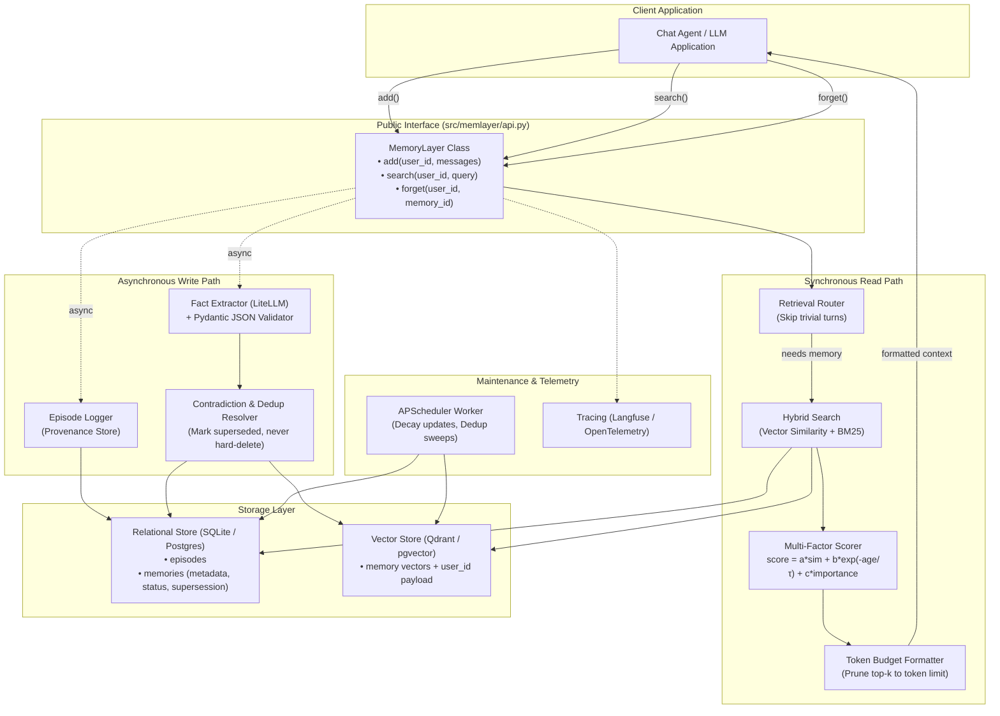

# Architecture: Agent Memory Layer (`memlayer`)

`memlayer` is a modular, typed Python library that equips conversational agents with persistent, long-term memory across chat sessions. It is designed for maximum transparency, rigorous benchmark reproducibility, and strict per-user privacy isolation.

---

## 1. System Overview



---

## 2. Core Architectural Principles

1. **Strict Per-User Isolation:** Every episode, memory item, vector point, and query must be explicitly scoped by `user_id`. Queries cannot cross user boundaries under any condition.
2. **Non-Blocking Write Path:** Extraction runs asynchronously after the response has been delivered to the user. Fast episode logging guarantees zero message loss.
3. **Non-Destructive Memory Updates:** When an update contradicts prior information (e.g. "moved to Bangalore" vs. "lives in Pune"), the outdated memory is marked `superseded` and linked via `superseded_by`. Memories are never silently deleted on conflict.
4. **Transparent, Multi-Factor Scoring:** Fact ranking combines semantic relevance, exponential recency decay, and intrinsic importance:
   $$\text{Score} = a \cdot \text{Similarity} + b \cdot \exp\left(-\frac{\text{age}}{\tau}\right) + c \cdot \text{Importance}$$
5. **Token-Budgeted Prompt Injection:** Facts are formatted with timestamps and provenance, strictly constrained within a caller-defined token budget.

---

## 3. Data Model

### 3.1 Relational Schema (`episodes`)
Stores raw dialogue history for complete provenance tracking.
- `id` (UUID / str, PK): Unique episode identifier.
- `user_id` (str, indexed): Owner identifier.
- `session_id` (str, indexed): Conversation session ID.
- `role` (str): `user` or `assistant`.
- `text` (str): Raw message content.
- `ts` (datetime): Timestamp message was received.

### 3.2 Relational Schema (`memories`)
Stores structured atomic facts extracted from episodes.
- `id` (UUID / str, PK): Unique memory identifier.
- `user_id` (str, indexed): Owner identifier.
- `content` (str): Atomic fact statement (e.g., "User prefers dark mode").
- `entity` (str, indexed): Subject or entity the fact relates to.
- `event_time` (datetime, nullable): When the event occurred (if specified).
- `created_at` (datetime): Timestamp memory was extracted.
- `importance` (float): Importance rating between 0.0 and 1.0.
- `confidence` (float): Extraction confidence score between 0.0 and 1.0.
- `status` (str): `active` or `superseded`.
- `superseded_by` (str, FK to memories.id, nullable): Pointer to newer superseding fact.
- `source_episode_id` (str, FK to episodes.id): Provenance link to source dialogue turn.
- `last_accessed_at` (datetime): Last time this memory was retrieved for context.
- `access_count` (int): Total number of times retrieved.

### 3.3 Vector Store Index
- Key: `memory_id`
- Vector: Dense embedding of `content` (via LiteLLM / sentence-transformers)
- Payload: `{ "user_id": str, "status": "active", "entity": str }`
- Search filter: `user_id == current_user AND status == 'active'`

---

## 4. Component Layout

```
src/memlayer/
├── api.py           # MemoryLayer orchestrator (public API)
├── models.py        # Pydantic v2 schemas
├── extract/         # Prompts, JSON extractor, and retry logic
├── store/           # Relational (SQLite/Postgres), episode log, vector store adapters
├── retrieve/        # Hybrid search, scoring formula, router, context formatter
├── consolidate/     # Deduplication, conflict detection, recency decay worker
├── llm/             # LiteLLM client wrappers and embedders
├── mcp_server.py    # Python MCP server implementation
└── tracing.py       # Langfuse / OpenTelemetry instrumentation
```
