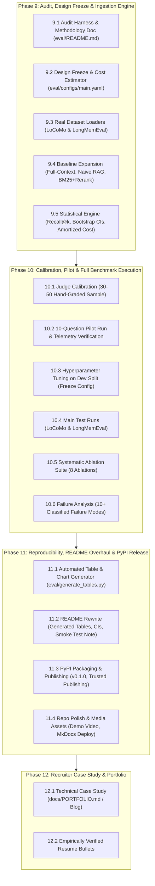

# Spec 020: Real Evaluation, Release & Portfolio Plan

## 1. Context & Motivation

In Milestones 1 through 8, `memlayer` established a complete, modular architecture:
- Asynchronous fact extraction with Pydantic validation
- Non-destructive contradiction resolution via supersession links
- Hybrid dense (vector) and sparse (BM25) search with multi-factor scoring
- Background consolidation worker (deduplication & access-count decay)
- Knowledge Graph layer (`InMemoryGraphStore` / `NetworkXGraphStore`) with multi-hop BFS pathfinding
- FastAPI service with 3-tab Memory Inspector and HTML5 Canvas Force-Directed visualizer
- WanderAI travel companion demo and official Python Model Context Protocol (MCP) server

However, as diagnosed in `memlayer-evaluation-and-release-plan.md`, the benchmark numbers currently presented in the README and evaluation reports derive from **4-question toy smoke tests** with stub/cached latencies (2–30 ms) and toy prompt lengths (~100 tokens). 

### The Core Problem:
1. **Zero Statistical Power:** 4 questions mean 1 question = 25% accuracy swings. Confidence intervals cannot be computed.
2. **Null Ablations:** 3 out of 4 ablations showed 0% delta because the 4 questions never exercised recency, decay, or BM25.
3. **Hidden Ingestion Costs:** Extracting facts requires LLM calls. Real cost equals query cost plus amortized ingestion cost over $Q$ queries per history.
4. **Credibility Risk:** Claiming "every design choice is backed by numbers" is the repository's core value proposition; presenting toy smoke tests as empirical benchmarks undermines credibility.

**Goal:** Transform `memlayer` from a well-engineered project with toy benchmark numbers into a defensible, reproducible, scientifically rigorous system with statistical power, followed by a formal PyPI release, media assets, and a portfolio-grade case study.

---

## 2. Phased Architecture & Execution Breakdown

---

## 3. Detailed Specifications per Phase

### Phase 9: Evaluation Harness Audit, Design Freeze & Ingestion Engine
- **Phase 9.1: Harness Audit & Methodology Documentation (`eval/README.md`)**
  - Audit existing `eval/` code: verify LLM invocations, embedding dimension (toy 64-dim vs real model), dataset sampling, cache mechanics, and judge uniformity.
  - Document all architectural methodology in `eval/README.md`.
- **Phase 9.2: Experimental Design Freeze & Cost Modeling (`eval/configs/main.yaml`, `eval/estimate_cost.py`)**
  - Freeze models across all comparisons:
    - **Answer Model:** Identical mid-size model across all systems (e.g. Gemini 1.5 Flash / GPT-4o-mini).
    - **Judge Model:** Recommended benchmark judge with category-specific prompts (e.g. Gemini 1.5 Pro / GPT-4o).
    - **Extraction Model:** Explicitly reported lightweight model (e.g. Llama-3-8B / Flash).
    - **Embedding Model:** Real dense embedder (e.g. `bge-small-en-v1.5` or `text-embedding-3-small`).
    - Fixed temperature = 0.0, deterministic random seeds.
  - Implement `eval/estimate_cost.py` calculating ingestion, query, judge tokens, and API expenditure buffers.
- **Phase 9.3: Real Dataset Loaders & Chronological Ingestion Protocol**
  - Implement `EvalItem` unified schema in `eval/datasets/models.py`.
  - Loaders for **LoCoMo** (large share / all available) and **LongMemEval** (stratified 100–150 question subset).
  - Replay conversational turns in strict chronological order with original timestamps.
  - Pass the question's stated date into retrieval/scoring as "now" (avoiding wall-clock distortions).
  - Enforce tenant isolation (`user_id` per haystack).
  - Persist SQLite memory databases per haystack for instant ablation reuse without re-ingestion.
- **Phase 9.4: Baseline Implementations**
  - **Full-Context:** Verbatim history concatenation (recording truncation if window exceeded).
  - **Naive RAG:** Chunked conversation sessions with dense similarity top-k.
  - **BM25 + Reranker:** Hybrid sparse + dense retrieval over raw chunks without fact extraction (answers: *"Why extract atomic facts at all?"*).
  - **MemLayer (Full):** Extracted facts, supersession links, hybrid scoring, and graph context.
- **Phase 9.5: Statistical Metrics Engine (`eval/stats.py`)**
  - Per-question JSONL logging (verdict, raw text, prompt/completion tokens, retrieval latency, total latency).
  - Retrieval recall@k metric against `evidence_ids` (decoupling retrieval failure from answer-model error).
  - 95% bootstrap confidence intervals ($N=10,000$ resamples) per system and category.
  - Paired bootstrap and McNemar's tests across systems.
  - Honest total cost formula:
    $$\text{Total Cost}(Q) = \text{Ingestion Cost} + Q \times \text{Query Cost}$$
    and compute break-even query count $Q^*$.

---

### Phase 10: Judge Calibration, Pilot & Main Benchmark Execution
- **Phase 10.1: Judge Calibration & Human Agreement**
  - Hand-grade 30–50 random judge verdicts.
  - Measure agreement rate ($\ge 90\%$). Calibrate judge prompts before starting expensive runs.
- **Phase 10.2: 10-Question Pilot Run**
  - Run 10 pilot questions across all systems.
  - Verify disk caching (`hash(model, prompt, params)`), telemetry recording, latency, and cost per question.
- **Phase 10.3: Hyperparameter Tuning on Dev Split Only**
  - Split questions into Dev (20–30%) and Test (70–80%).
  - Tune $\alpha, \beta, \gamma, \tau, k$, and token budget on Dev split only.
  - Commit frozen config tagged `eval-v1`. Test split run once.
- **Phase 10.4: Main Test Execution**
  - Run LoCoMo test set first (economical multi-question haystack sharing).
  - Run LongMemEval test set second.
  - Save full per-question JSONL outputs in `eval/results/`.
- **Phase 10.5: Systematic Ablation Suite**
  - Execute 8 ablations reusing ingested stores:
    1. Without supersession
    2. Without decay
    3. Without recency scoring ($\beta=0$)
    4. Vector-only (no BM25)
    5. Without router (always retrieve)
    6. Without graph context
    7. Small vs larger extraction model
    8. Token budget sweep (200, 500, 1000, 2000 tokens)
- **Phase 10.6: Failure Analysis**
  - Classify 10+ wrong answers into: Extraction Miss, Supersession Failure, Retrieval Miss (low recall@k), Budget Truncation, Answer Model Error, Judge Error.

---

### Phase 11: Reproducibility, README Overhaul & PyPI Release
- **Phase 11.1: Automated Table & Chart Generator (`eval/generate_tables.py`, Makefile)**
  - Script parsing JSONL result files and outputting GitHub Markdown tables with 95% CIs and latency percentiles.
  - `make eval-smoke` (CI 4-question stub run) and `make eval-full` (reproducible benchmark).
- **Phase 11.2: README Benchmark Overhaul**
  - Replace toy tables with generated tables.
  - Add explicit methodology, sample size $n$, 95% CIs, category breakdowns, and break-even analysis.
  - Include smoke test disclaimer: "The 4-question runs in CI verify pipeline correctness, not benchmark accuracy."
- **Phase 11.3: PyPI Packaging & Publishing (v0.1.0)**
  - Verify package name availability.
  - Finalize `pyproject.toml` metadata (description, authors, license, classifiers, entry points).
  - Build wheel with `uv build`.
  - Test on TestPyPI; publish v0.1.0 to PyPI using GitHub Actions trusted publishing.
- **Phase 11.4: Repository Polish & Media Assets**
  - GitHub description, topics, `CONTRIBUTING.md`, issue templates.
  - Deploy MkDocs documentation (`mkdocs gh-deploy`).
  - Record 2-minute demo video / GIF (City Move, WanderAI, Memory Inspector).

---

### Phase 12: Recruiter Case Study & Portfolio Artifacts
- **Phase 12.1: Case Study Write-Up (`docs/PORTFOLIO.md` / Blog Post)**
  - Problem statement, architectural diagrams, statistical results with CIs.
  - "What did not work": failed ideas, ablations with zero delta, surprising failure modes.
  - Cost and latency reality: ingestion cost, p95 latencies, break-even analysis.
- **Phase 12.2: Empirically Verified Resume Bullets**
  - Populate resume templates strictly from verified numbers in `eval/results/`.

---

### Phase 13: Post-Release Advanced Features Backlog
- **Phase 13.1:** Automatic Knowledge Graph triplet extraction from dialogue turns.
- **Phase 13.2:** Fact extraction precision & recall benchmark on 100 hand-labeled turns.
- **Phase 13.3:** Memory poisoning and prompt injection defense (adversarial attack set, trust scoring, quarantine).

---

## 4. Acceptance Criteria & Definition of Done

1. [ ] Real LLM (LiteLLM) and real embedding model used across all benchmark runs.
2. [ ] At least 100 questions per benchmark in the test split, strictly separated from dev split.
3. [ ] All baselines (Full-Context, Naive RAG, BM25+Reranker, MemLayer) evaluated under identical answer models, judges, and prompts.
4. [ ] 95% bootstrap confidence intervals and paired difference tests reported for all accuracy metrics.
5. [ ] Honest total cost accounting including amortized ingestion and break-even point $Q^*$.
6. [ ] Human agreement rate on LLM judge verdicts $\ge 90\%$ on 30+ sample items.
7. [ ] Failure analysis classifying at least 10 concrete failure cases.
8. [ ] README tables programmatically generated from committed JSONL outputs via `eval/generate_tables.py`.
9. [ ] `make eval-smoke` (CI fast check) and `make eval-full` (reproducible run) functional.
10. [ ] `memlayer` v0.1.0 published on PyPI and installable via `pip install memlayer`.
11. [ ] Live MkDocs documentation site deployed.
12. [ ] Portfolio case study published with verified numbers and interview talking points.
